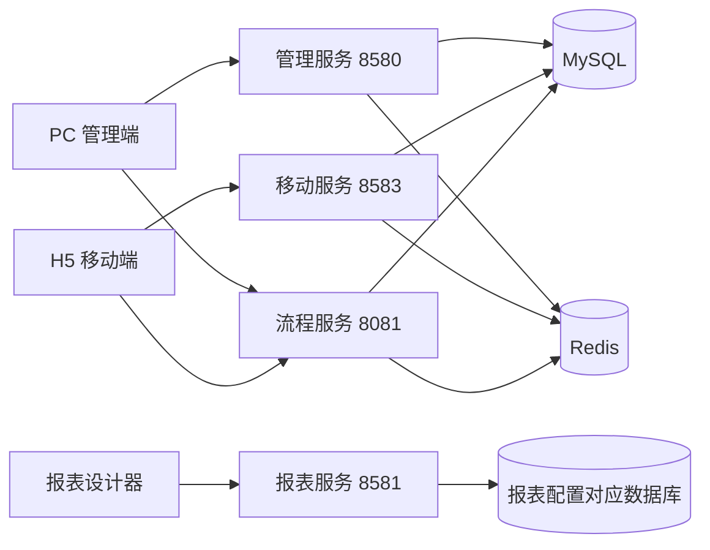

# 架构与模块职责

本文描述当前公开工程的结构和连接关系，供阅读源码及安排本地开发使用。实际工具版本由各模块 POM、package.json 与锁文件确定；本页不构成部署拓扑已经运行验收的证明。

## 应用与服务



图中端口来自当前开发配置，共享数据库部分表示入门配置思路，不是生产部署要求。对象存储、模型、邮件、协同平台等外部依赖按功能另行配置。

| 服务/客户端 | 职责 | 入口 |
| --- | --- | --- |
| 管理服务 | 聚合系统、生成器、AI、能力开放、消息、任务等插件 | [forge-admin-server](../forge-server/forge-admin-server/) |
| 移动服务 | 提供移动客户端所需 API | [forge-app-server](../forge-server/forge-app-server/) |
| 流程服务 | 承载流程引擎、任务和流程相关接口 | [forge-flow-server](../forge-server/forge-flow/forge-flow-server/) |
| 流程客户端 | 供其他模块接入流程相关协议和调用 | [forge-flow-client](../forge-server/forge-flow/forge-flow-client/) |
| 报表服务 | 报表/可视化工程的后端 | [forge-report-server](../forge-server/forge-report-server/) |
| PC 管理端 | 管理、设计及业务应用运行界面 | [forge-admin-ui](../forge-admin-ui/) |
| H5 移动端 | uni-app 工程的移动网页入口 | [forge-h5-ui](../forge-h5-ui/) |
| 报表设计器 | 画布、图表、项目和预览界面 | [forge-report-ui](../forge-report-ui/) |

管理端 Vite 将一般接口转发到 8580，将流程及工作台路径转发到 8081；H5 将一般接口转发到 8583，流程和业务审批路径转发到 8081；报表端将 `/forge-report-api` 转发到 8581。排查代理问题时应先区分这些服务。

## 后端分层

```text
forge-server/
├── forge-admin-server/       管理应用入口
├── forge-app-server/         移动应用入口
├── forge-report-server/      报表应用入口
├── forge-flow/               流程服务与客户端
├── forge-business/           业务扩展
├── forge-framework/
│   ├── forge-dependencies/   依赖管理
│   ├── forge-starter-parent/ 通用技术组件
│   ├── forge-plugin-parent/  按业务能力组织的插件
│   ├── forge-lowcode-api/    共享低代码协议
│   ├── forge-lowcode-runtime/低代码运行执行
│   └── forge-lowcode-formula/公式执行
└── db/                      基础结构、种子与迁移
```

Starter 提供认证、Web、ORM、缓存、租户、数据范围、文件、Excel、日志、加密等技术能力。Plugin 提供系统管理、生成器、数据、流程、任务、消息、AI、外部集成与能力开放等功能。服务入口选择并组合所需依赖，模块是否实际启用应查看服务 POM 和运行配置。

## 低代码设计与运行

- **设计端**负责业务对象、字段、表单、页面、应用及流程关联配置。
- **共享 API**承载设计端、运行端与生成代码使用的公共协议。
- **运行时**处理动态查询、数据投影、字段映射、写入校验、编号及数据源访问等业务执行。
- **公式模块**承载公式解析与执行相关职责。
- **生成器**保留设计和代码生成能力，生成后的业务代码仍需遵守权限、校验和模块依赖。

对应前端主要位于[应用中心](../forge-admin-ui/src/views/app-center/)、[低代码组件](../forge-admin-ui/src/components/lowcode-builder/)和[公共 CRUD 组件](../forge-admin-ui/src/components/ai-form/)。更细的前端结构见[低代码 CRUD 报告](低代码%20CRUD%20前端架构全景报告.md)。

## 权限、租户与数据

用户身份、客户端身份、角色资源权限、组织/数据范围及租户是不同维度。前端按钮和路由用于界面呈现，服务端接口和数据访问仍需执行各自约束。新增业务不能仅复制页面而遗漏 API 资源、写入授权或数据范围。

数据模型与迁移位于[数据库目录](../forge-server/db/)。公开初始化文件移除了历史数据和连接信息，只提供清理后的结构及公共静态元数据、演示身份。已有业务数据库应使用经审阅的升级路径，不能重新导入初始化文件覆盖。

## 国际化

PC、H5、报表分别维护语言资源；后端接收请求语言并提供消息和显示元数据，数据库通过前向迁移增加需要的显示字段。语言切换用于显示，业务编码、权限标识、原始字段值、用户正文及历史附件保持其原本含义。扩展业务应明确区分显示标签和机器标识。

## 与 Harness 的边界

[交付隔离台](https://github.com/zhiyuxinxi/ForgeAdminHarness-open-source)管理 AI 辅助开发与交付过程，本工程承载应用功能。接入时需要选定公开基线、仓库、模型及执行环境；不会因两个仓库相互链接就自动建立运行连接。

## 开发入口

首次开发请按[本地开发指南](getting-started.md)操作。具体的公开安装缺口见[版本状态](release-status.md)；前端组件开发见[前端文档导航](../forge-admin-ui/docs/README.md)，贡献说明见[CONTRIBUTING](../CONTRIBUTING.md)。
